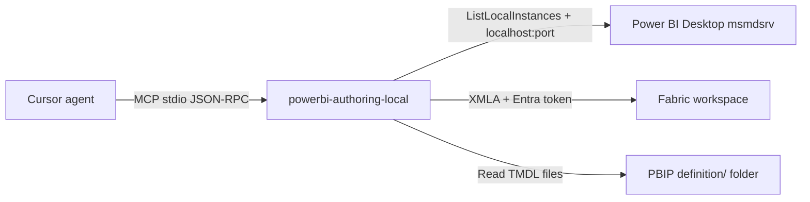

# How Power BI Authoring MCP connections work

The local server (`@microsoft/powerbi-modeling-mcp`) is an MCP stdio process.
It does **not** open `.pbix` files itself. It talks to a *semantic model host*
through the Tabular Object Model (TOM). There are three hosts.



## 1. Power BI Desktop (what `Connect to 'ITSM_Service_Intelligence.pbix'` means)

1. You open `ITSM_Service_Intelligence.pbix` in **Power BI Desktop**.
2. Desktop starts a hidden Analysis Services engine (`msmdsrv.exe`) on a
   **random localhost port** (often above 50000).
3. The MCP tool `connection_operations` / `ListLocalInstances` finds those
   processes and their ports.
4. The server matches the `.pbix` file name to the local database catalog.
5. It connects with Windows integrated auth:

   `Data Source=localhost:<port>`

That path is **same-machine and Windows-only**. Microsoft's ADOMD client on
.NET Core refuses Desktop attach on Linux:

> This feature is supported for a .NET Core client only on Windows systems.

A Cloud Agent VM has no `PBIDesktop.exe`, no `msmdsrv.exe`, and no `.pbix`.
`ListLocalInstances` therefore returns **0**. Passing the file name as a
connection string is wrong: the server treats it as a hostname.

## 2. Fabric workspace

Connect with workspace + semantic model name (or IDs). The server uses the
Azure Identity chain (environment / managed identity / Azure CLI / browser)
and XMLA:

`powerbi://api.powerbi.com/v1.0/myorg/<Workspace>`

This can work from Linux if XMLA is enabled and you can authenticate. It is
**not** a Desktop `.pbix` connection.

## 3. Power BI Project (PBIP / TMDL) — the Cloud Agent path

Save the Desktop file as a Power BI Project and commit the
`*.SemanticModel/definition` TMDL folder. Then:

```text
connection_operations / ConnectFolder
folderPath = <repo>/....SemanticModel/definition
```

The server loads TMDL into an **in-memory TOM model**. No Desktop, no XMLA.
You can list tables, measures, and relationships. You cannot execute DAX or
refresh, because there is no Analysis Services engine.

This repo already proved that path with `models/SampleSales`.

## What this Cloud Agent can and cannot do

| Target | This Linux Cloud Agent |
| --- | --- |
| Cursor-attached MCP started as `cmd.exe /c npx ...` | Fails unless a `cmd.exe` shim is on PATH |
| Local MCP binary `--readonly` | Works |
| Desktop `.pbix` (`ITSM_Service_Intelligence.pbix`) | **Cannot connect** |
| Fabric XMLA | Possible with Entra credentials |
| PBIP/TMDL on disk | Works (read-only ConnectFolder) |

## How to connect to `ITSM_Service_Intelligence.pbix` for real

**On Windows, with Desktop (the request you made):**

1. Open `ITSM_Service_Intelligence.pbix` in Power BI Desktop and leave it open.
2. In Cursor MCP settings use `npx`, not `cmd.exe`:

```json
{
  "mcpServers": {
    "powerbi-authoring-local": {
      "command": "npx",
      "args": ["-y", "@microsoft/powerbi-modeling-mcp@latest", "--start", "--readonly"]
    }
  }
}
```

3. Run the agent **on that same Windows machine** (local agent, or a Windows
   self-hosted worker with Desktop installed). Cloud Linux VMs cannot see
   your Desktop instance.
4. Ask: `Connect to 'ITSM_Service_Intelligence.pbix' in Power BI Desktop.`

**On this Cloud Agent (Linux):**

1. In Desktop: **File → Save as → Power BI project (.pbip)**.
2. Commit `ITSM_Service_Intelligence.SemanticModel/definition`.
3. Ask the agent to `ConnectFolder` on that definition directory.
4. Keep `--readonly` if you do not want modeling writes.

Do not unzip a `.pbix` and expect TMDL. A `.pbix` is a zip plus a binary
Analysis Services database, not a git-friendly model definition.
